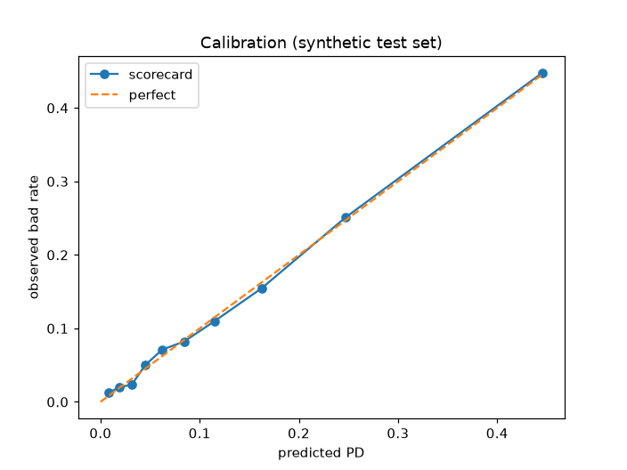

# Credit-risk PD scorecard (WoE / IV, synthetic data)

A classic application-scorecard workflow for personal loans: Weight-of-Evidence binning, Information Value screening, a logistic PD model, points scaling (PDO), and validation with AUC, Gini, KS, Brier score and a calibration curve.

> **All data is synthetic.** `src/scorecard/data.py` generates 30,000 fictional applicants (bureau score, income, FOIR, employer vintage, enquiries, past 30+ DPD). No real borrower data is used, and the results say nothing about any real portfolio.

## Run

```bash
pip install -r requirements.txt
PYTHONPATH=src python -m scorecard.train   # writes reports/
python -m pytest -q                        # 4 tests
```

## Results (from `reports/metrics.json`, seed 7, 30% holdout = 9,000 applicants)

| Metric | Value |
|---|---|
| Bad rate | 12.22% |
| AUC | 0.802 |
| Gini | 0.604 |
| KS | 0.457 |
| Brier score | 0.090 |
| Max calibration gap (10 quantile bins) | 0.9 pp |
| Score range on test set | 424 to 668 |

Information Value (train set):

| Feature | IV | Kept (IV >= 0.02) |
|---|---|---|
| bureau_score | 0.891 | yes |
| foir | 0.180 | yes |
| dpd30_12m | 0.113 | yes |
| enquiries_6m | 0.081 | yes |
| employer_vintage_m | 0.056 | yes |
| monthly_income | 0.020 | no (just below the cut-off) |

Scaling: 600 points = 50:1 good:bad odds, 20 points to double the odds. Points per bin are in [`reports/scorecard_points.csv`](reports/scorecard_points.csv).



## Not included (would be needed in production)

Coarse-classing review and monotonic bin merging, reject inference, out-of-time validation, PSI/CSI monitoring, and model-risk documentation.

MIT licensed.
